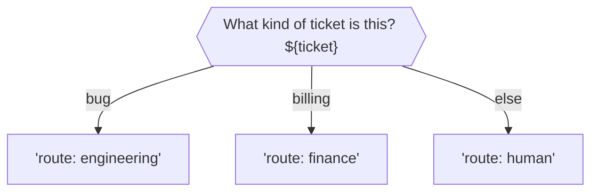

# merman - the executable mermaid



```bash
$ merman run README.md --set ticket="there is a borg in my lamborghini"
route: engineering
```

Run mermaid flowcharts as programs. The diagram is the program: nodes are Python
expressions, shell commands or LLM prompts (via [jerry](https://github.com/paniq/jerry)),
and the value a node produces picks the outgoing edge.

Standard library only, Python 3.9+. One file: `merman.py`.

```
merman run  diagram.md [--set NAME=VALUE]... [--stdin-json] [--max-steps N] [--timeout S]
                       [--echo] [--trace] [--report FILE] [--dry-run] [--block N | --all-blocks]
                       [--ignore CODE]... [--jerry PATH] [--llm-arg ARG]...
                       [--llm-retries N]
merman lint diagram.md [--block N | --all-blocks] [--ignore CODE]... [--strict] [--set NAME[=VALUE]]...
```

Exit codes: the terminal node's result (a shell node's exit code is forwarded),
64 usage, 65 parse or lint error, 70 runtime error (R001 no match, R002 node failure,
R003 step limit, R004 timeout), 130 interrupted.

## Markdown files with several diagrams

`--block N` picks one ```` ```mermaid ```` block (1-based). `--all-blocks` runs every block in order of
declaration with one shared context, so later diagrams can use what earlier ones bound. All blocks
are linted before any runs, and the run stops at the first block that fails or exits non-zero (that
code is merman's exit code). Without either option, a file with several blocks is an error.

## Nodes

| Kind | Default shape | Prefix | Result |
|---|---|---|---|
| python | `[ ]` `( )` `{ }` | `py:` | the expression's value |
| shell | `[[ ]]` | `sh:` | exit code (stdout goes to `_out`) |
| llm | `{{ }}` | `ask:` | the response text |

`name := ...` binds a node's result (stdout for shell nodes). The context is shared:
Python nodes use it as their globals, shell nodes get it as environment variables, LLM
prompts use shell-style `${var}` templating: `${score:-85}` falls back to 85 when `score` is unset or empty, `${score-85}` only when it is unset, and `\${` is a literal `${`. After each node `_`, `_out`, `_err`, `_rc` and `_steps` are set.

## Edge labels

| Label | Meaning |
|---|---|
| `ok` | equality (compared as strings) |
| `'*'` | forced literal |
| `else` or `*` | default edge |
| `/re/i` | regex (`re.search`) |
| `[1..5)` `(..5]` `[a..f]` | range, numeric or lexical |
| `<x` `<=x` `>x` `>=x` `!=x` | comparison, numeric or lexical |
| `*.txt` `a?c` | glob |

Quote anything with `[`, `(`, `|`, `<` or `>` for mermaid: `-->|"[1..5)"|`. Edges are
tried in declaration order, then the default. No match and no default is runtime error R001.
A node's single unlabeled edge is a consequence; mixing labeled and unlabeled edges is
rejected. A node with no outgoing edges ends the run, and its result is the program output.

## Directives

Mermaid comments, so rendering is unaffected:

```
%% merman: start=check
%% merman: timeout=10
%% merman: check timeout=60
%% merman: allow-no-exit
```

## Debugging LLM nodes

`--trace` prints every step to stderr. For LLM nodes it also shows the prompt, the answer format appended to it,
jerry's reasoning and the **raw response**, and it runs jerry with `-r`. Anything jerry writes to stderr on a successful call (for example with
`--llm-arg=-r` or `--llm-arg=-v`) is passed through to merman's stderr. If a diagram always takes its
`else` edge, look at the response line: matching is exact and case-sensitive, so `Billing.` does not
match the label `billing`. Use a regex label such as `-->|"/^billing/i"|` to be more forgiving.

## Lint codes

Errors: E001 parse, E002 mixed edges, E003 several unlabeled, E004 several defaults,
E005 bad label, E006 empty body, E007 unknown start, E008 bad directive, E009 not a Python expression.
Warnings: W001 no exit path, W002 unreachable, W003 duplicate label, W004 shadowed label,
W005 overlapping ranges, W006 no default edge, W007 unset template variable, W008 subgraph
flattened, W009 unknown directive, W010 node without text.

## Tests

```
python3 -m unittest discover -s tests
```

The LLM tests use `tests/fake_jerry.py`, so no model server is needed.
